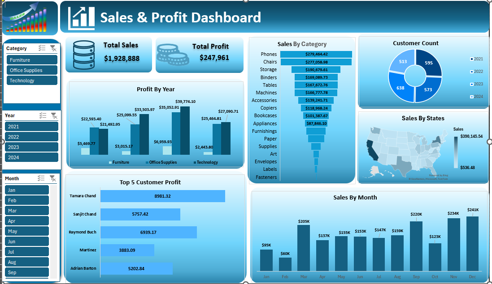

# 📊 Sales & Profit Dashboard | Microsoft Excel

## 📌 Project Overview

This project focuses on analyzing sales and profit performance using an interactive dashboard built in Microsoft Excel. It provides insights into product categories, customer profitability, yearly performance, monthly sales trends, and geographical sales distribution.

The dashboard helps users understand business performance through visual reports, KPIs, and interactive filters.

## 🖥️ Dashboard Preview

## 📈 Key Performance Indicators (KPIs)

- 💰 **Total Sales:** $1,928,888
- 💹 **Total Profit:** $247,961

## 📊 Dashboard Features

1. 💰 **Sales & Profit KPIs:** Displays overall sales and profit.
2. 📅 **Profit by Year:** Compares yearly profit across product categories.
3. 🛒 **Sales by Category:** Analyzes sales performance across product sub-categories.
4. 👥 **Customer Count:** Shows customer distribution across different years.
5. 🏆 **Top 5 Customer Profit:** Identifies customers contributing the highest profit.
6. 🗺️ **Sales by States:** Visualizes geographical sales distribution across the United States.
7. 📆 **Sales by Month:** Highlights monthly sales trends.

## 🎛️ Interactive Filters (Slicers)

The dashboard includes interactive slicers for:

- 🛍️ Category
- 📅 Year
- 🗓️ Month

These filters allow users to explore the data based on different business dimensions.

## 🛠️ Tools & Technologies Used

- 📗 Microsoft Excel
- 📊 PivotTables
- 📈 PivotCharts
- 🎛️ Excel Slicers
- 🔍 Data Analysis
- 📉 Data Visualization
- 🎨 Dashboard Design

## 📂 Dataset Information

The dataset contains sales transaction details, including:

- Order Date
- Customer Name
- State
- Category
- Sub-Category
- Product Name
- Sales
- Quantity
- Profit
- Month
- Year

## 🎯 Business Objectives

- Analyze overall sales and profit performance.
- Identify high-performing product categories and sub-categories.
- Understand monthly and yearly sales trends.
- Identify the most profitable customers.
- Compare sales performance across different states.
- Support business decisions through interactive data visualization.

## 📚 Key Learnings

- Creating interactive dashboards using Microsoft Excel.
- Working with PivotTables and PivotCharts.
- Using slicers for dynamic data filtering.
- Analyzing sales and profit KPIs.
- Presenting business insights through data visualization.

## 📁 Project Files

- 📗 `Sales and Profit Dashboard Data(1).xlsx` - Excel workbook containing the dataset, PivotTables, and dashboard.
- 🖼️ `SalesandProfitdashboard.png` - Dashboard preview.

## 🏁 Conclusion

This project demonstrates practical skills in Excel-based data analysis, business reporting, and dashboard development. It transforms raw sales data into meaningful visual insights that can help businesses monitor performance and make informed decisions.

---

⭐ If you find this project useful, feel free to explore the repository!
